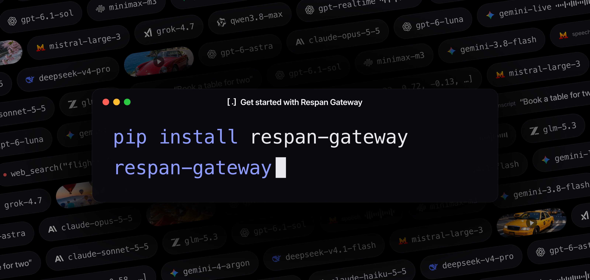
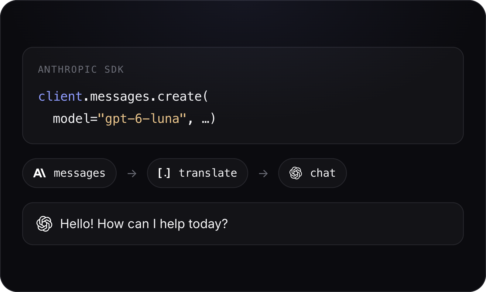
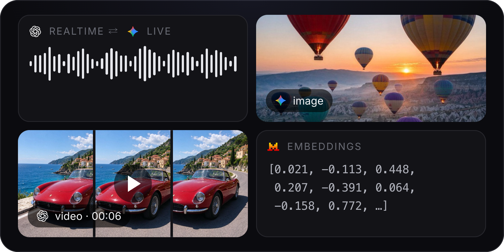
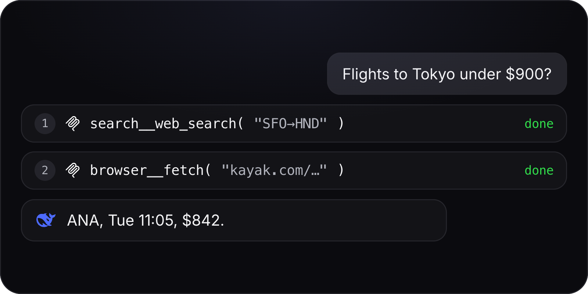
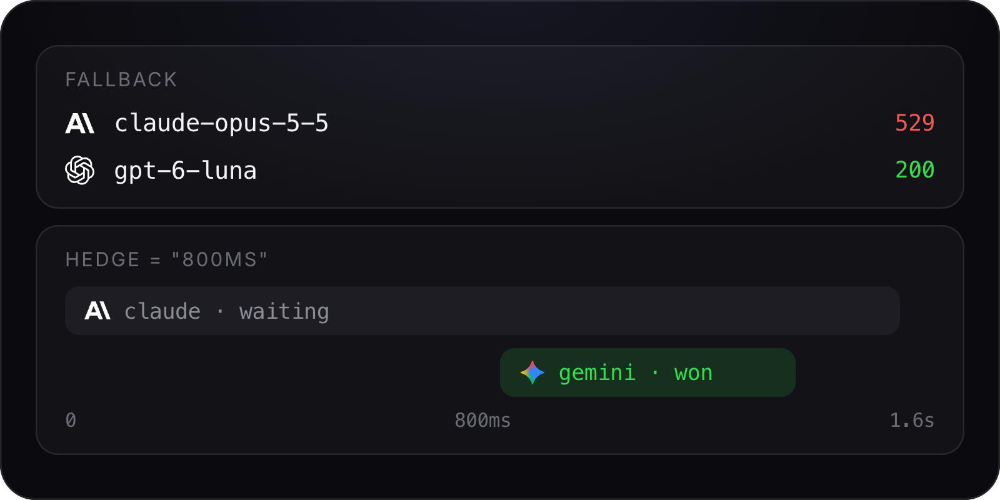
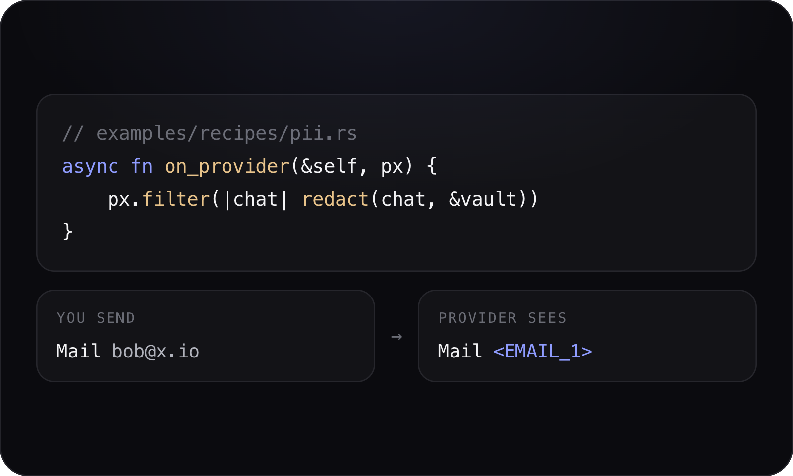
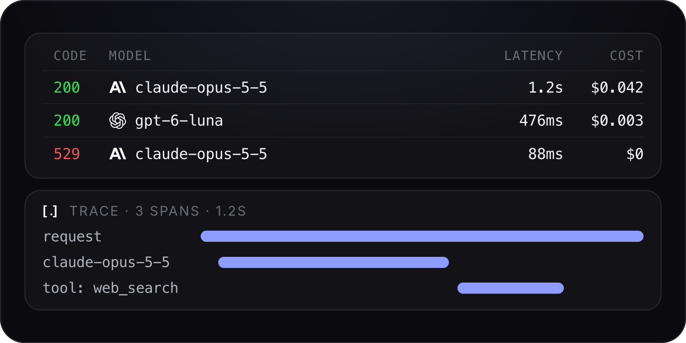

<div align="center">
  <a href="https://www.respan.ai">
    <picture>
      <source media="(prefers-color-scheme: dark)" srcset="docs/assets/respan-wordmark-dark.svg">
      
    </picture>
  </a>

  <h3>Respan Gateway: one universal adapter for AI.</h3>

  <p>
    <a href="https://www.ycombinator.com/companies/respan"></a>
    <a href="https://pypi.org/project/respan-gateway/"></a>
    <a href="https://crates.io/crates/respan-gateway"></a>
    <a href="#license"></a>
    <a href="https://discord.com/invite/KEanfAafQQ"></a>
  </p>

  <p>
    <a href="#quickstart"><b>Quickstart</b></a> ·
    <a href="https://www.respan.ai/docs/oss-gateway/introduction"><b>Docs</b></a> ·
    <a href="https://www.respan.ai/models"><b>Hosted models</b></a> ·
    <a href="https://gateway.respan.ai"><b>Endpoints</b></a> ·
    <a href="https://www.youtube.com/watch?v=pVv2ibXiTXM"><b>▶ Demo</b></a>
  </p>
</div>

**Respan Gateway** is an open-source AI gateway: a single Rust binary between
your code and every AI API. Not just LLMs: chat, realtime voice, images,
video, speech, embeddings and tools, from every major provider. Point the SDK
you already use at it, and call any of them, with fallback, tools and a live
log of every call built in.

<p align="center">
  
</p>

## Features

<table>
<tr>
<td width="55%" valign="middle">

### Keep your SDK, call any model

OpenAI, Anthropic and Gemini clients can all call any chat model. Streaming, tools, images and reasoning are translated both ways.

[Docs →](docs/vendors.md)

</td>
<td width="45%"></td>
</tr>
<tr>
<td width="55%" valign="middle">

### Multimodal

Realtime voice (OpenAI Realtime ⇄ Gemini Live), images, video, speech, transcription and embeddings, through the same gateway and the SDKs you already use.

[Docs →](docs/vendors.md)

</td>
<td width="45%"></td>
</tr>
<tr>
<td width="55%" valign="middle">

### Server-side tools

Put MCP servers or built-in tools (web search, browsers, code sandboxes, memory) behind the gateway. It runs the tool loop server side, so any model can use them from a plain chat call.

[Docs →](docs/mcp.md)

</td>
<td width="45%"></td>
</tr>
<tr>
<td width="55%" valign="middle">

### Built-in fallback and retries

A failed call falls back to the next provider, with retries and backoff. Hedged requests race a slow provider against the next one. Pick the first, cheapest or fastest.

[Docs →](docs/configuration.md)

</td>
<td width="45%"></td>
</tr>
<tr>
<td width="55%" valign="middle">

### Your own plugin in minutes

One trait, four hooks: a plugin is a few lines of Rust, on the same API every built-in feature uses. Start from a recipe: guardrails, PII masking, billing or an LLM judge.

[Docs →](docs/plugins.md)

</td>
<td width="45%"></td>
</tr>
<tr>
<td width="55%" valign="middle">

### Built-in observability

Telemetry is built in: the web UI logs every call's cost, latency and tokens, and with a Respan key every request is traced in [Respan](https://respan.ai).

[Docs →](docs/configuration.md)

</td>
<td width="45%"></td>
</tr>
</table>

## Quickstart

**1. Install**

```bash
pip install respan-gateway
```

<details>
<summary>Other ways to install</summary>

| | |
|---|---|
| Shell script | `curl -fsSL https://raw.githubusercontent.com/respanai/respan-gateway/main/install.sh \| sh` |
| Cargo | `cargo install respan-gateway` |
| Docker | `docker run -p 8080:8080 -e OPENAI_API_KEY -e RESPAN_CLIENT_KEYS=<your key> ghcr.io/respanai/respan-gateway` |
| Binaries | [GitHub releases](https://github.com/respanai/respan-gateway/releases) for macOS, Linux and Windows |
| Inside Python | [Run it in-process](python/README.md), with no server |
| Inside Rust | [Mount it in your own service](docs/plugins.md#in-a-gateway-of-your-own) |

</details>

**2. Run it with a provider key**

```bash
export OPENAI_API_KEY=sk-...
respan-gateway
```

No config file needed: every provider whose key is set is ready. No provider
keys? One [Respan key](https://www.respan.ai/models) (`RESPAN_API_KEY`) reaches
every hosted model. The web UI is at [localhost:8080/ui/](http://localhost:8080/ui/).

**3. Call any model from the SDK you already use**

```python
from anthropic import Anthropic

client = Anthropic(base_url="http://localhost:8080", api_key="unused")
reply = client.messages.create(
    model="gpt-6-luna",
    max_tokens=256,
    messages=[{"role": "user", "content": "Hello!"}],
)
print(reply.content[0].text)
```

The real provider keys stay in the gateway, so `api_key` can be anything.

## Works with your SDK

Anything with a base URL works. Set it to the gateway and keep your code:

| SDK | Base URL |
|---|---|
| OpenAI (Chat Completions or Responses) | `http://localhost:8080/v1` |
| Anthropic | `http://localhost:8080` |
| Google GenAI | `http://localhost:8080` |

Guides: [OpenAI SDK](https://www.respan.ai/docs/integrations/gateway/open-ai-sdk) ·
[Anthropic SDK](https://www.respan.ai/docs/integrations/gateway/anthropic-sdk) ·
[Google GenAI](https://www.respan.ai/docs/integrations/gateway/google-gen-ai) ·
[Vercel AI SDK](https://www.respan.ai/docs/integrations/gateway/vercel-ai-sdk) ·
[LangChain](https://www.respan.ai/docs/integrations/gateway/lang-chain) ·
[Pydantic AI](https://www.respan.ai/docs/integrations/gateway/pydantic-ai) ·
[OpenCode](https://www.respan.ai/docs/integrations/gateway/open-code) ·
[more](https://www.respan.ai/docs/integrations/gateway/overview)

## Providers

26 providers, plus any OpenAI-compatible endpoint.

<p>
  <picture><source media="(prefers-color-scheme: dark)" srcset="docs/assets/vendors/openai-dark.svg"></picture>&nbsp;&nbsp;<picture><source media="(prefers-color-scheme: dark)" srcset="docs/assets/vendors/anthropic-dark.svg"></picture>&nbsp;&nbsp;&nbsp;&nbsp;<picture><source media="(prefers-color-scheme: dark)" srcset="docs/assets/vendors/xai-dark.svg"></picture>&nbsp;&nbsp;&nbsp;&nbsp;&nbsp;&nbsp;<picture><source media="(prefers-color-scheme: dark)" srcset="docs/assets/vendors/groq-dark.svg"></picture>&nbsp;&nbsp;<picture><source media="(prefers-color-scheme: dark)" srcset="docs/assets/vendors/openrouter-dark.svg"></picture>&nbsp;&nbsp;&nbsp;&nbsp;&nbsp;&nbsp;&nbsp;&nbsp;&nbsp;&nbsp;&nbsp;&nbsp;&nbsp;&nbsp;&nbsp;&nbsp;<picture><source media="(prefers-color-scheme: dark)" srcset="docs/assets/vendors/ollama-dark.svg"></picture>&nbsp;&nbsp;
</p>

Also Amazon Bedrock, MiniMax, StepFun, Phonic, Morph, EmpirioLabs, TypeSafe
and Respan. [All providers and what each supports →](docs/vendors.md)

| | Your code calls | Reaches |
|---|---|---|
| **Chat** | OpenAI Chat Completions, OpenAI Responses, Anthropic Messages, Gemini | Any chat model |
| **Realtime voice** | OpenAI Realtime, Gemini Live | OpenAI ⇄ Gemini, Mistral, StepFun, Phonic |
| **Images** | OpenAI Images, Gemini Images | OpenAI, Gemini, xAI, Bedrock, OpenRouter and more |
| **Video** | OpenAI Videos, Gemini Veo | Veo, OpenRouter, DeepInfra |
| **Speech, transcription, embeddings** | OpenAI | OpenAI, Gemini, Mistral, Groq, Bedrock and more |
| **Tools** | MCP | Your MCP servers and [built-in tools](docs/tool-vendors.md) |
| **Anything else** | A provider's own API | Passed through untouched |

## Performance

| | Respan Gateway | Bifrost | Portkey | LiteLLM (1 worker) |
|---|---:|---:|---:|---:|
| Added latency (p50) | **0.07 ms** | 0.16 ms | 0.17 ms | 4.34 ms |
| Throughput | **56,734/s** | 18,182/s | 4,187/s | 268/s |
| Memory | **31 MB** | 488 MB | 350 MB | 418 MB |
| 1k streams, success | **100%** | 92–100% | — | 79% |
| p99 with 5% slow calls | **105 ms** | 2,002 ms | 2,003 ms | 2,024 ms |

## Configuration

Start without a config file. When you need more, `respan-gateway init` writes
a commented `gateway.toml`:

```toml
client_keys = [{ name = "app", key = "env:APP_KEY" }]  # who may call the gateway

[providers.anthropic]                   # a known provider: just add a key
vendor = "anthropic"
key = "env:ANTHROPIC_API_KEY"

[providers.local]                       # any OpenAI-compatible endpoint
formats = ["openai-chat"]
base_url = "http://localhost:8000/v1"

[routes.smart]                          # clients ask for model "smart"
to = ["anthropic/claude-haiku-5-5", "openai/gpt-6-luna"]
hedge = "800ms"                         # race the second if the first is slow
```

`respan-gateway check` validates it, and `--watch` reloads it without a
restart. See [configuration](docs/configuration.md), [MCP and tools](docs/mcp.md)
and the full [`gateway.example.toml`](gateway.example.toml).

## Extend it

Every feature is a plugin on one public Rust API: one trait, four hooks.
Write your own from the [plugin guide](docs/plugins.md), or start from an
[example](examples/README.md): guardrails, PII masking, billing, an LLM judge.

## Community

- Questions and ideas: [Discord](https://discord.com/invite/KEanfAafQQ) or [Discussions](https://github.com/respanai/respan-gateway/discussions)
- Missing a provider or feature? [Open an issue](https://github.com/respanai/respan-gateway/issues/new/choose)
- Want to contribute? Read [CONTRIBUTING.md](CONTRIBUTING.md) and pick a [good first issue](https://github.com/respanai/respan-gateway/labels/good%20first%20issue). A new provider is usually one file.
- Security issues: see [SECURITY.md](SECURITY.md)

Want it managed? [Respan](https://respan.ai/ai-gateway) runs the gateway for
you, with dashboards and evals.

<a href="https://github.com/respanai/respan-gateway/graphs/contributors">
  
</a>

## License

[MIT](LICENSE-MIT) or [Apache-2.0](LICENSE-APACHE), at your option.
